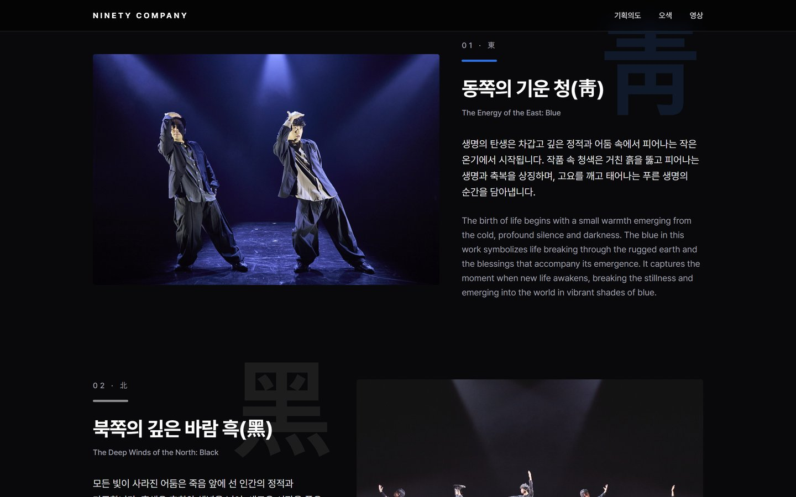
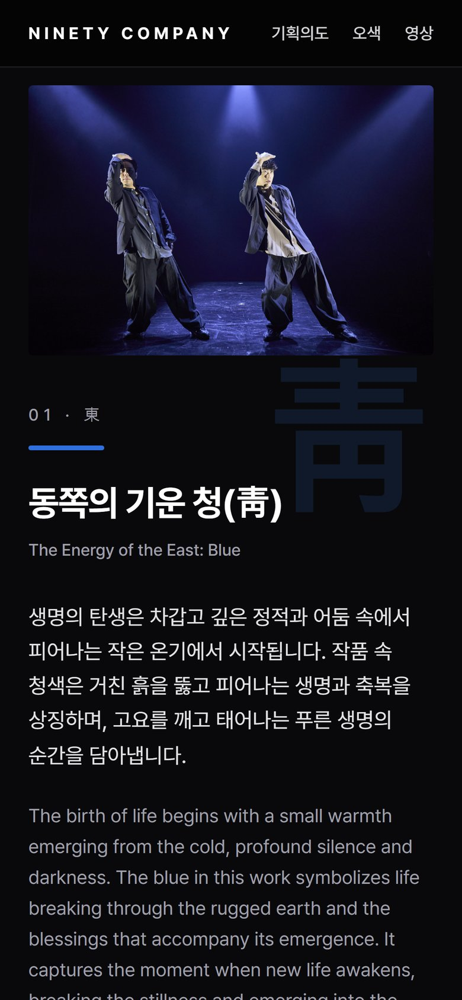
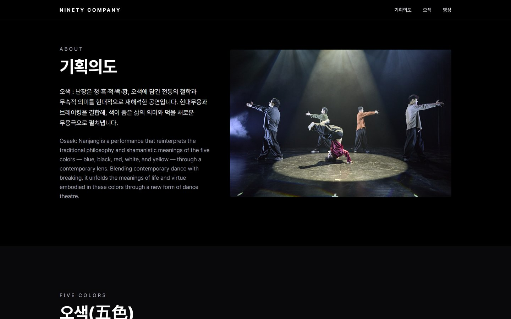

# 오색 : 난장 — Ninety Company

나인티 컴퍼니의 공연 「오색 : 난장」 소개 페이지입니다.
청·흑·적·백·황, 오색에 담긴 전통의 철학과 무속적 의미를 현대무용과 브레이킹으로 재해석한 무용극을 한 페이지로 소개합니다.

## 화면

| 데스크톱 | 모바일 |
|---|---|
|  |  |
|  |  |



## 구성

- **히어로** — 하이라이트 영상을 무음 배경으로 재생(타이틀 카드·엔딩을 뺀 9~142초 구간 반복), 정지 버튼 제공, 동작 줄이기 설정 시 메인 사진으로 대체
- **기획의도** → **오색(청·흑·적·백·황) 5장면** → **하이라이트 영상** → 푸터
- 문구·사진 데이터는 `src/content/osaek.ts` 한 곳에서 관리

## 개발

```bash
npm install
npm run dev     # http://localhost:3000
npm run build
```

Next.js 16 · React 19 · Tailwind CSS 4 · Motion · Pretendard
